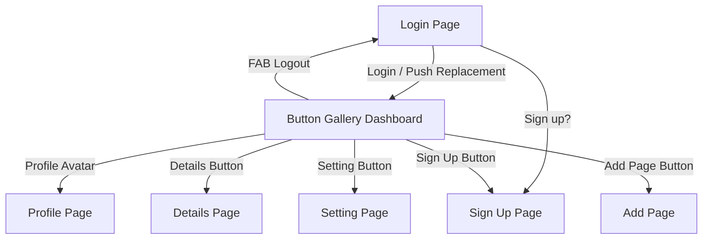

# Flutter Buttons & Navigation Showcase

A Flutter application demonstrating various Material Design 3 button types, custom button styling, input forms, and multi-screen navigation routes.

---

## 📱 Project Overview

This project showcases the implementation and usage of Flutter's Material Design button widgets, navigation paradigms (`Navigator.push`, `pushReplacement`, named routes), and form layouts across 7 interactive screens.

---

## 🚀 Features & Button Showcase

### Demonstrated Button Types

| Button Type | Implementation Location | Action / Functionality |
| :--- | :--- | :--- |
| **Elevated Button** | `login.dart`, `details.dart`, `profile.dart` | Form submission, navigation, and modal dismissal |
| **Filled Button** | `home.dart` | Navigates to Settings screen |
| **Filled Tonal Button** | `home.dart` | Custom-styled button navigating to Add screen |
| **Outlined Button** | `home.dart` | Navigates to Sign Up screen |
| **Text Button** | `login.dart`, `home.dart` | Auxiliary actions (e.g., "Sign up?" link) |
| **Icon Button** | `signup.dart`, `home.dart` | Close modal action and AppBar profile avatar trigger |
| **Floating Action Button (FAB)** | `home.dart` | Logout action (replaces view with Login screen) |
| **Segmented Button** | `home.dart` | Interactive calendar view selector (Day, Week, Month, Year) |
| **Custom-Styled Buttons** | `login.dart`, `signup.dart`, `profile.dart` | Custom background/foreground colors, rounded borders, and custom elevations via `ElevatedButton.styleFrom` |

---

## 📂 File & Directory Structure

```text
lib/
├── main.dart       # App entry point, MaterialApp setup, and route table definitions
├── login.dart      # Authentication screen with custom buttons and input fields
├── signup.dart     # User registration screen with social sign-in options and form fields
├── home.dart       # Button Gallery dashboard featuring Material 3 buttons & navigation
├── profile.dart    # User profile view displaying user information and action controls
├── details.dart    # Details view displaying item information with return navigation
├── add.dart        # Add section view accessed via Tonal Filled button
└── setting.dart    # Settings view accessed via Filled button
```

---

## 🧭 Application Navigation Flow



1. **Login Screen (`/`)**: Initial entry point. Logging in routes to the **Home Screen** using `pushReplacement`.
2. **Button Gallery Dashboard (`/buttons`)**: Central hub containing all button widgets:
   - **Profile Avatar**: Opens the Profile screen.
   - **Details Button**: Opens the Details screen (`Navigator.push`).
   - **Setting Page Button**: Opens the Settings screen (`Navigator.push`).
   - **Sign Up Button**: Opens the Sign Up screen (`Navigator.push`).
   - **Add Page Button**: Opens the Add screen via named route (`/add`).
   - **FAB (Exit/Logout)**: Returns to the Login screen (`pushReplacementNamed`).
3. **Sign Up Screen**: Accessible from Login or Home; includes a close `IconButton` to pop back to the previous screen.

---

## ⚙️ Prerequisites & Installation

### Requirements
- **Flutter SDK**: `>=3.12.0`
- **Dart SDK**: `>=3.0.0`

### Setup Instructions

1. **Clone the repository:**
   ```bash
   git clone <repository-url>
   cd Flutter-Buttons-And-Navigation-main
   ```

2. **Install dependencies:**
   ```bash
   flutter pub get
   ```

3. **Analyze the codebase:**
   ```bash
   flutter analyze
   ```

4. **Run the application:**
   ```bash
   flutter run
   ```

---

## 🎨 UI & Design Highlights

- **Material 3 Integration**: Demonstrates current Material Design buttons (`FilledButton`, `FilledButton.tonal`, `SegmentedButton`).
- **Form Layouts**: Styled input text fields with rounded borders and password obscuration.
- **Responsive Layouts**: Use of `SingleChildScrollView`, `Column`, `Row`, `Expanded`, and `Container` margins for structured alignment across screen sizes.
